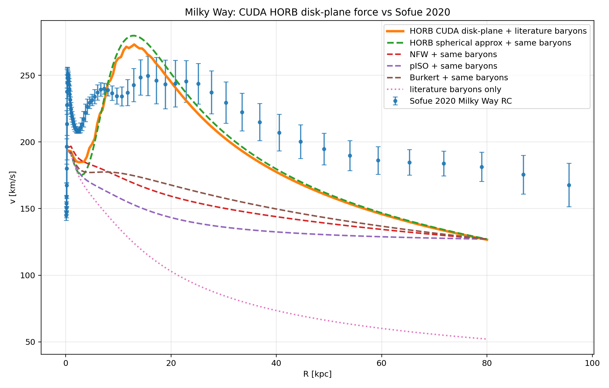

# horb - Hydrogenic Orbital Radial Basis

Rust/CUDA Simulation Suite For Testing Hydrogen Electron Orbitals As Spiral Galaxy Dark Matter Halos

## Project tool

Use `./run.sh` for the operations menu, or run commands directly:

```sh
./run.sh build all                 # CUDA + Rust (Jetson Orin default: sm_87)
./run.sh check                     # CPU tests and tool format check
./run.sh check plots               # Python comparison/scoring/plot tests
./run.sh do mw-comparison          # CPU comparison, including Einasto
./run.sh do cuda-candidate         # build, run and plot the current MW candidate
./run.sh do orbital-views 1.5 1e11  # make density graphs
./run.sh graphs                    # list graphs
./run.sh view                      # open the latest graph
./run.sh dump                      # uniquely named current-source dump
./run.sh dump --data               # source dump including input tables
```

Use `./run.sh build` for a CPU-only build. Source dumps include local edits and
new source files, plus branch/commit details, for sharing current code in a
conversation. All operations live in the Rust `tool/` crate; the previous shell
workflows have been migrated. See [tool/README.md](tool/README.md) for commands,
dependencies, scan overrides, dry runs and the old-to-new command mapping.

## Classical halo comparisons

The comparison suite includes **NFW, pseudo-isothermal, Burkert and Einasto**.
Einasto uses the slope-minus-two radius `r_minus2` and shape parameter `alpha`;
the default MW comparison uses `r_minus2=15 kpc`, `alpha=0.18`. Both are
configurable. Each classical baseline is normalized to the specified enclosed
mass at the reference radius, and total curves use the same baryonic model.

```sh
./run.sh run curve halo einasto 15 2.5e11 80 0.18
./run.sh do mw-comparison 1.0 2.5e11 2.5e11 15.0 0.18
./run.sh do cuda-candidate 1.0 2.5e11 96 80 0.25 15.0 0.18
./run.sh view
```

The two comparison workflows write graphs and score tables for every model.
These are fixed-parameter diagnostics; the defaults are not optimized fits.
See [the Einasto model notes](docs/einasto.md) for the equations, CSV fields,
normalization and scoring ranges. M31 fitting is available below; the full
SPARC importer remains planned.

## Signed orbital-density fitting

The fitter now searches orbital choices, scales from a configurable grid,
component counts, and **positive or negative density weights**. It adds signed
disk-plane force contributions before computing the total circular speed.

```sh
./run.sh --release do signed-fit cpu
./run.sh view
./run.sh view plots/mw_signed_cpu_density.png
```

The default CPU calculation uses nonspherical, axisymmetric multipoles. The
workflow writes the fitted curve, signed component weights, candidate rankings,
a reproducibility report, and rotation/density graphs. A CUDA direct-force
quadrature backend is also available with `do signed-fit cuda`.

The default example run selects three components and gives **4.43 km/s RMS**
on the 29 Sofue observations in the fitted 5–80 kpc interval. This is an
in-sample result with fixed baryons. See [signed-density fitting](docs/signed_density.md)
for the equations, search controls, example weights and validation limits.

## Andromeda (M31)

The repository includes Corbelli et al. (2010), Table 1: **29 observed HI
rotation-curve points from 8.5 to 36.5 kpc**, with the published error bars.
The workflow prepares the data offline and uses a fixed Geehan et al. (2006)
bulge, thin exponential disk and central mass. This simplified baseline has
no separately resolved gas component.

```sh
./run.sh --release do m31-signed-fit cpu
./run.sh view plots/m31_signed_cpu_rotation.png
./run.sh --release do m31-signed-fit cpu --name m31_anneal --search anneal
```

The default run selected three signed terms with **3.43 km/s in-sample RMS**.
Sources, baryonic assumptions, input hashes and fit settings are included in
the report. See [the M31 data and reproduction notes](data/m31/README.md).
M31 is a separate dataset from SPARC's 175 galaxies.

## Reality has a fractal geometry. Modern Physics is a cult of continuum religion.

- **Step 0:** Modern philosiphy takes Physics models and derives ontology, a system built by complete morons. We need the correct ontology first.
  
- **Step 1:** The final fundamental laws of physics must be self-contained in the universe they describe and cannot rely on external “flying spaghetti monster” concepts. This recursion forces dynamic fractals to be the only viable geometric ontology.

- **Step 2:** Classical continuum physics is built from averages and should fail at fractal scale boundaries.

- **Step 3:** The clearest boundary objects where classical physics fails are atoms with quantized energy and galaxies with flat rotation curves.

- **Step 4:** Assume Galaxy → Atom to define the scale factor.

- **Step 5:** Apply that independently defined scale factor to the Sun’s Schwarzschild–de Sitter balance radius:
  - Solar balance radius: $r_{\mathrm{SdS},\odot}=\left(\frac{3GM_\odot}{\Lambda c^2}\right)^{1/3}\approx3.42\times10^{18}\,\mathrm{m}$
  - Scaled prediction: $\frac{r_{\mathrm{SdS},\odot}}{S_{G\to A}}\approx3.83\times10^{-13}\,\mathrm{m}$
  - Electron reduced Compton wavelength: $\bar{\lambda}_e=\frac{\hbar}{m_ec}\approx3.86\times10^{-13}\,\mathrm{m}$
  - Therefore: **Star ↔ Electron** ; Electric force is a gas-likesource/sink pressure dynamics.

- **Step 6:** Apply extremal three-charge microstate counting to Sagittarius A*:
  - Black-hole entropy: $S_{\mathrm{BH}}=\frac{4\pi GM_{\mathrm{SgrA^*}}^2}{\hbar c}\approx1.94\times10^{90}$
  - Three-charge entropy: $S_{\mathrm{BH}}=2\pi\sqrt{Q_1Q_5N}$
  - Equal-channel depth: $\ln Q_i=\frac{1}{3}\ln(Q_1Q_5N)\approx137.37$
  - Quantized register depth: $\left\lfloor\ln Q_i\right\rfloor=137$
  - This gives a finite, quantized crossing condition and the photonic mechanism.

- **Step 7:** The fractal continues beyond atoms and galaxies; the next lower scales appears as dark matter.

- **Step 8:** HORB tests the claim by fitting galactic rotation curves with hydrogenic orbital structure. And they beat every PhD-developed model.


## Earlier single-orbital benchmark

The earlier single-orbital Milky Way candidate is a morphology-constrained hydrogenic `3d_z2` halo tested against the Sofue 2020 unified Milky Way rotation curve using a literature bulge+disk baryonic model and a CUDA direct-summation disk-plane force calculation.

| Parameter | Value |
|---|---:|
| Orbital state | `3d_z2` |
| Orbital scale `a0_star` | `1.0 kpc` |
| HORB dark halo mass | `2.5e11 M_sun` |
| HORB force model | CUDA disk-plane direct summation |
| Grid size | `96^3` mass cells |
| Grid extent | `±80 kpc` |
| Softening length | `0.25 kpc` |
| Baryon model | Sofue literature bulge+disk |
| Stellar disk mass | `3.41e10 M_sun` |
| Stellar disk scale | `3.19 kpc` |
| Bulge mass | `1.652e10 M_sun` |
| Bulge scale | `0.522 kpc` |

Using the same literature baryonic model for every halo, the CUDA HORB candidate is compared directly against the previous spherical HORB approximation and against NFW, pseudo-isothermal, and Burkert halo baselines, with all curves plotted against the Sofue 2020 unified Milky Way rotation curve.

The embedded image below records that earlier three-baseline comparison.
Regenerating it with `do cuda-candidate` now also includes Einasto and writes
all-model score tables; the archived image itself has not been replaced.



This benchmark replaces the earlier spherical-enclosed-mass approximation. The CUDA calculation evaluates the actual disk-plane gravitational response of the non-spherical `3d_z2` orbital density field. The result lowers the mid-radius HORB peak relative to the spherical approximation, which is exactly the region where the spherical model overshot the observed Milky Way rotation curve.

The plot is generated reproducibly by:

```bash
./run.sh do cuda-candidate 1.0 2.5e11 96 80 0.25
```


## Motivation

Standard computational astrophysics models spiral-galaxy dark-matter halos using smooth, parametric density curves (e.g., NFW, Burkert, Einasto). While these phenomenological profiles function as flexible data-fitting forms, they are rarely constrained by independent, non-spherical geometric observables. 

The **HORB** (`Hydrogenic Orbitals Radial Basis`) engine is built to test a radically different, morphology-first alternative: evaluating whether a scaled hydrogenic orbital density field centered on the Galactic core can simultaneously resolve macroscopic geometry (Fermi Bubbles) and dynamics (Flat Rotation Curves). Preliminary morphology indicates that the real angular probability density of the hydrogen $3d_{z^2}$ orbital:

$$\rho_{\Omega}(\theta) \propto \left(3\cos^2\theta - 1\right)^2$$

reproduces the distinctive bipolar lobe geometry, equatorial waist, and $54.74^\circ$ nodal cone opening structure of the Milky Way's Fermi bubbles. 


## CUDA Build Note

The CUDA shared library `libhorb_cuda.so` is intentionally ignored by git because it is a local build artifact. On a fresh clone, build it before running CUDA tests:

```bash
./run.sh build all
./run.sh check all
```

## License

This project is dual-licensed under either:

* Apache License, Version 2.0 ([LICENSE-APACHE](LICENSE-APACHE) or http://www.apache.org/licenses/LICENSE-2.0)
* MIT license ([LICENSE-MIT](LICENSE-MIT) or http://opensource.org/licenses/MIT)

at your option.
