# horb - Hydrogenic Orbital Radial Basis

Rust/CUDA Simulation Suite For Testing Hydrogen Electron Orbitals As Spiral Galaxy Dark Matter Halos

## Milky Way: rotation curve and fitted dark density

**Seven curves, one dataset:** the best found HORB squared-density superposition,
the new **signed-ψ lobe** superposition, quantised inertia (QI), NFW, Burkert,
Einasto, and baryons alone. All use the same fixed
baryons and observed error bars. HORB and the three classical halos are fitted;
[QI is a fixed prediction](docs/quantised_inertia.md) with no fitted parameters.

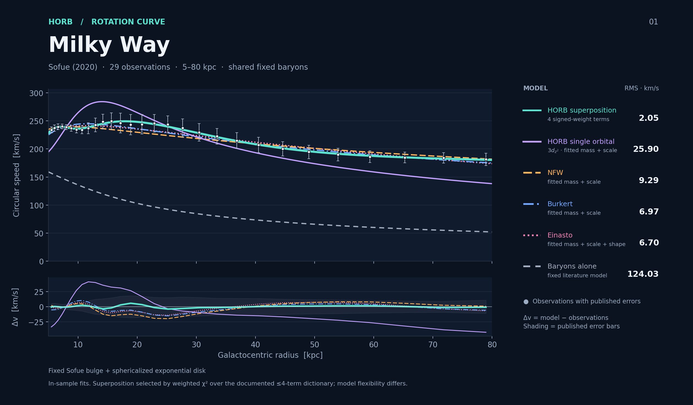

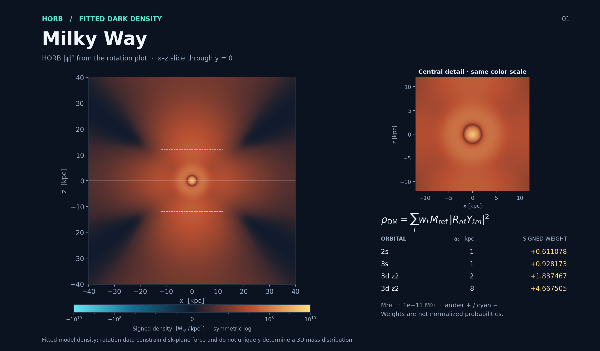

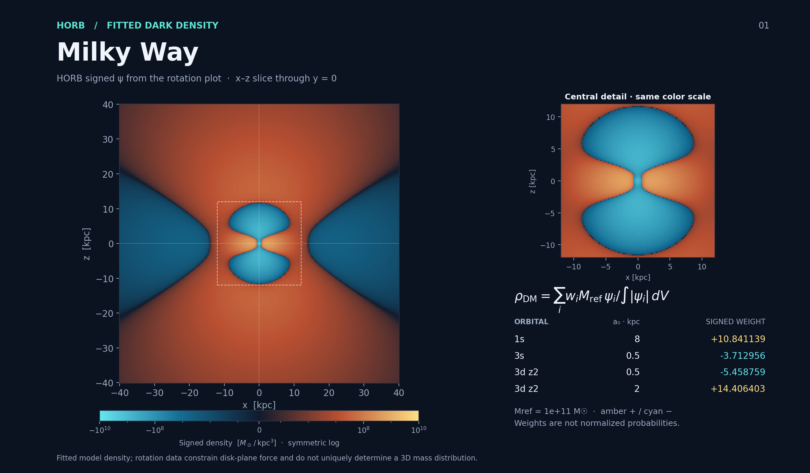

## Andromeda: rotation curve and fitted dark density

The same comparison using Corbelli et al. (2010) observations and fixed
Geehan et al. (2006) baryons. Each density map uses its rotation fit's exact
weights; amber is positive density and cyan is negative density.

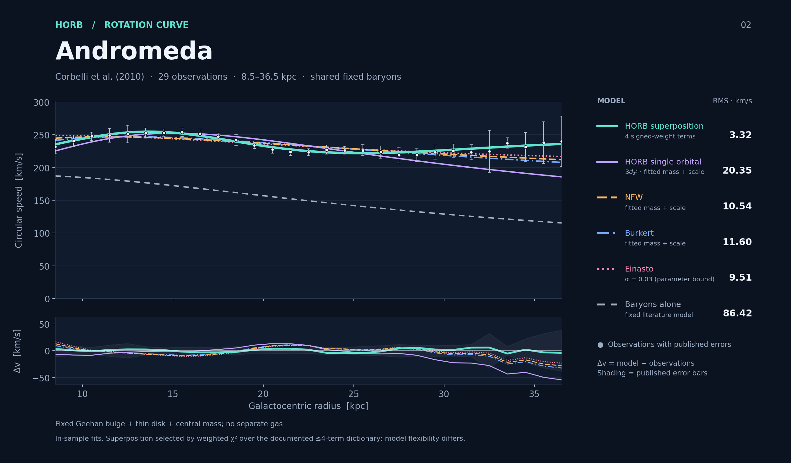

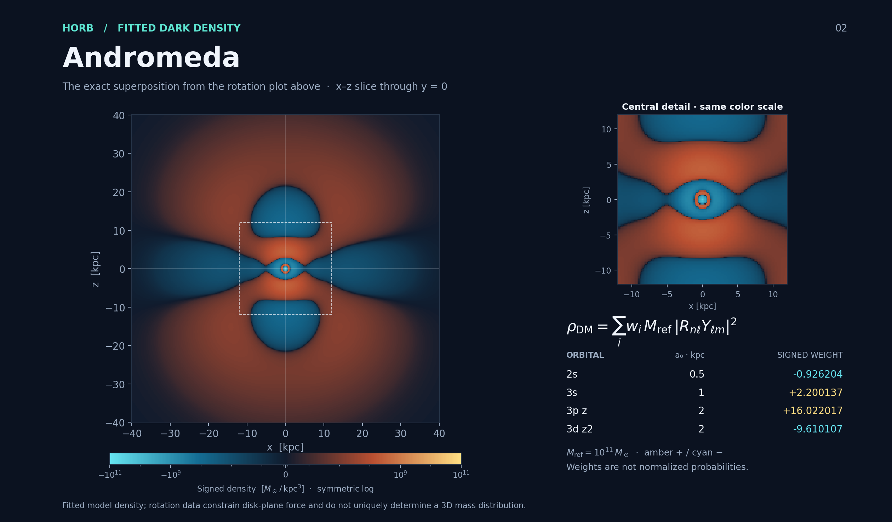

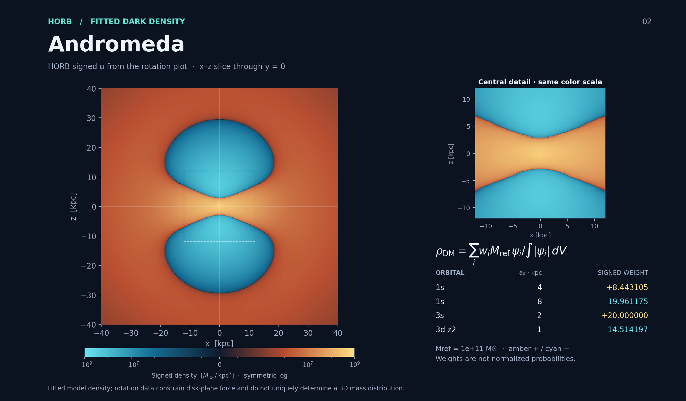

<!-- HORB_HIGHLIGHT_SCORES_START -->

| In-sample RMS (km/s) | Milky Way · 5–80 kpc | Andromeda · 8.5–36.5 kpc |
|---|---:|---:|
| HORB squared density · 4 terms | **2.05** | **3.32** |
| HORB signed ψ · lobe signs retained | **3.08** | **3.23** |
| QI · fixed prediction | 37.13 | 14.00 |
| NFW · fitted mass + scale | 9.29 | 10.54 |
| Burkert · fitted mass + scale | 6.97 | 11.60 |
| Einasto · fitted mass + scale + shape | 6.70 | 9.51 |
| Baryons alone · fixed | 124.03 | 86.42 |

<!-- HORB_HIGHLIGHT_SCORES_END -->

“Best” here means the lowest converged weighted χ² found after trying all
31,931 squared-density subsets (30 columns) and 6,196 signed-ψ subsets
(20 identifiable columns), each with up to four weights. The squared MW search
had no failures; two squared M31 subsets did not converge. Both ψ searches
had no failures. These are in-sample
comparisons with different model flexibility, not a model-probability test.
The M31 Einasto fit reaches the configured lower shape bound, `alpha=0.03`.
The M31 baryonic baseline has no separately resolved gas component. The
density maps depict fitted models, not unique reconstructions from observations.

```sh
./run.sh --release do readme-highlights          # rebuild MW, M31, J2141 and AGC 114905 figures
./run.sh --release do readme-highlights --refit  # repeat both complete subset searches too
```

The two density definitions are separate: `squared` uses |ψ|² with fitted
coefficients; `psi` uses the real signed wavefunction divided by its absolute
mass integral. Zero-net-mass lobes retain their gravitational contribution.
See [equations, sign conventions and commands](docs/signed_lobes.md).

The PNGs, fitted weights, scores and plotted curves are committed. The command
also exports PDF figures. See [figure methods and reproduction](docs/readme_highlights.md)
and [the numerical records](data/highlights/README.md).

## AGC 114905: including the zero-orbital solution

The same seven-model comparison uses the 2024 paper's Figure 7 scenario,
**digitized from its vector figure**, with its distance and inclination held
fixed for every model. The all-zero HORB coefficients give the baryons-only
curve: **RMS 4.76 km/s** on these five points. The updated data do not favor
that zero solution. Four weights can nearly interpolate five points, so the
very small HORB residuals are below extraction precision, not a unique physical
reconstruction. [Data provenance and limitations](data/agc114905/README.md).

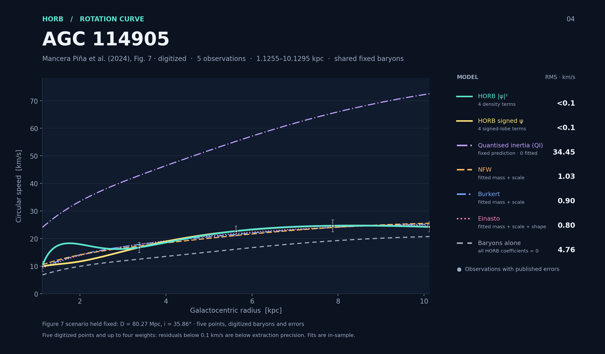

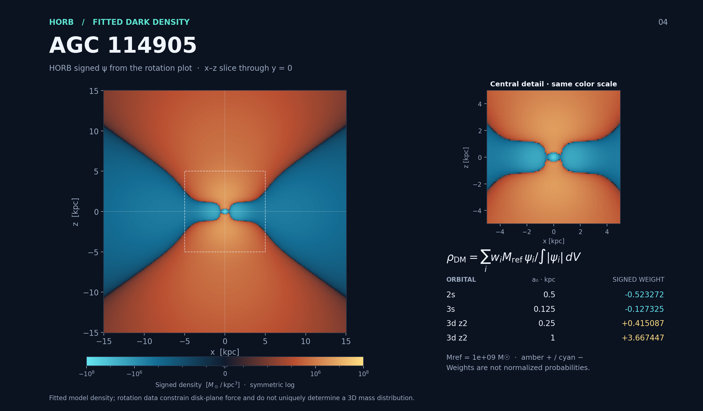

```sh
./run.sh --release do agc114905-fit
```

## Fit all 175 SPARC galaxies

The official SPARC catalog and all **3,391 rotation-curve measurements** are
bundled with their gas, disk and bulge contributions. The batch workflow fits
both density definitions by default, saves matching rotation/density plots, and builds a
searchable gallery. Completed fits are verified and skipped when resuming.

```sh
./run.sh --release do sparc-fit --name sparc175 --jobs 2
./run.sh view plots/sparc/sparc175/index.html
```

All 175 galaxies are included, with published quality flags preserved. Defaults
use fixed disk/bulge M/L = 0.5/0.7 and a 30-column orbital dictionary scaled to
each galaxy for |ψ|² and 20 columns for signed ψ. Both models completed
**175/175 fits**: median in-sample RMS is **1.09 km/s (|ψ|²)** and
**1.41 km/s (ψ)**. Signed ψ has lower weighted χ² in 19/175 galaxies in this
beam search. [All scores, both sets of weights and activity joins](data/sparc/density_comparison_20261126/README.md).
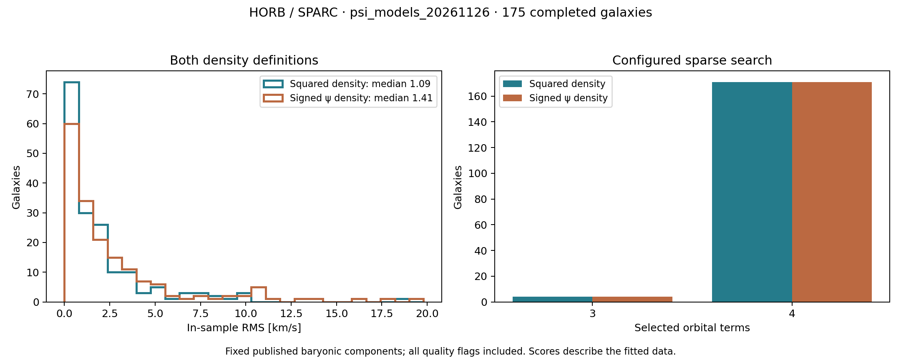

Scores describe the fitted observations. See [SPARC commands and
methods](docs/sparc.md) and [the attributed source data](data/sparc/README.md).

## Project tool

Use `./run.sh` for the operations menu, or run commands directly:

```sh
./run.sh build all                 # CUDA + Rust (Jetson Orin default: sm_87)
./run.sh check                     # CPU tests and tool format check
./run.sh check plots               # Python comparison/scoring/plot tests
./run.sh do mw-comparison          # CPU comparison, including Einasto
./run.sh do cuda-candidate         # build, run and plot the current MW candidate
./run.sh do orbital-views 1.5 1e11  # make density graphs
./run.sh graphs                    # list graphs
./run.sh view                      # open the latest graph
./run.sh dump                      # uniquely named current-source dump
./run.sh dump --data               # source dump including input tables
```

Use `./run.sh build` for a CPU-only build. Source dumps include local edits and
new source files, plus branch/commit details, for sharing current code in a
conversation. All operations live in the Rust `tool/` crate; the previous shell
workflows have been migrated. See [tool/README.md](tool/README.md) for commands,
dependencies, scan overrides, dry runs and the old-to-new command mapping.

## Classical halo comparisons

The comparison suite includes **NFW, pseudo-isothermal, Burkert and Einasto**.
Einasto uses the slope-minus-two radius `r_minus2` and shape parameter `alpha`;
the default MW comparison uses `r_minus2=15 kpc`, `alpha=0.18`. Both are
configurable. Each classical baseline is normalized to the specified enclosed
mass at the reference radius, and total curves use the same baryonic model.

```sh
./run.sh run curve halo einasto 15 2.5e11 80 0.18
./run.sh do mw-comparison 1.0 2.5e11 2.5e11 15.0 0.18
./run.sh do cuda-candidate 1.0 2.5e11 96 80 0.25 15.0 0.18
./run.sh view
```

The two comparison workflows write graphs and score tables for every model.
These are fixed-parameter diagnostics; the defaults are not optimized fits.
See [the Einasto model notes](docs/einasto.md) for the equations, CSV fields,
normalization and scoring ranges. M31 fitting is available below; the complete SPARC sample is available above.

## Signed orbital-density fitting

The fitter now searches orbital choices, scales from a configurable grid,
component counts, and **positive or negative density weights**. It adds signed
disk-plane force contributions before computing the total circular speed.

```sh
./run.sh --release do signed-fit cpu
./run.sh view
./run.sh view plots/mw_signed_cpu_density.png
```

The default CPU calculation uses nonspherical, axisymmetric multipoles. The
workflow writes the fitted curve, signed component weights, candidate rankings,
a reproducibility report, and rotation/density graphs. A CUDA direct-force
quadrature backend is also available with `do signed-fit cuda`.

The default fast beam-search example selects three components and gives **4.43 km/s RMS**
on the 29 Sofue observations in the fitted 5–80 kpc interval. This is an
in-sample result with fixed baryons. See [signed-density fitting](docs/signed_density.md)
for the equations, search controls, example weights and validation limits.

## Andromeda (M31)

The repository includes Corbelli et al. (2010), Table 1: **29 observed HI
rotation-curve points from 8.5 to 36.5 kpc**, with the published error bars.
The workflow prepares the data offline and uses a fixed Geehan et al. (2006)
bulge, thin exponential disk and central mass. This simplified baseline has
no separately resolved gas component.

```sh
./run.sh --release do m31-signed-fit cpu
./run.sh view plots/m31_signed_cpu_rotation.png
./run.sh --release do m31-signed-fit cpu --name m31_anneal --search anneal
```

The default fast beam-search run selected three signed terms with **3.43 km/s in-sample RMS**.
Sources, baryonic assumptions, input hashes and fit settings are included in
the report. See [the M31 data and reproduction notes](data/m31/README.md).
M31 is a separate dataset from SPARC's 175 galaxies.

## Reality has a fractal geometry. Modern Physics is a cult of continuum religion.

- **Step 0:** Modern philosiphy takes Physics models and derives ontology, a system built by complete morons. We need the correct ontology first.
  
- **Step 1:** The final fundamental laws of physics must be self-contained in the universe they describe and cannot rely on external “flying spaghetti monster” concepts. "The perfect description of the law of the universe is the universe following its own law". This tautological recursion forces dynamic fractals to be the only viable geometric ontology.

- **Step 2:** Classical continuum physics is built from averages and should fail at fractal scale boundaries.

- **Step 3:** The clearest boundary objects where classical physics fails are atoms with quantized energy and galaxies with flat rotation curves.

- **Step 4:** Assume Galaxy → Atom to define the scale factor.

- **Step 5:** Apply that independently defined scale factor to the Sun’s Schwarzschild–de Sitter balance radius:
  - Solar balance radius: $r_{\mathrm{SdS},\odot}=\left(\frac{3GM_\odot}{\Lambda c^2}\right)^{1/3}\approx3.42\times10^{18}\,\mathrm{m}$
  - Scaled prediction: $\frac{r_{\mathrm{SdS},\odot}}{S_{G\to A}}\approx3.83\times10^{-13}\,\mathrm{m}$
  - Electron reduced Compton wavelength: $\bar{\lambda}_e=\frac{\hbar}{m_ec}\approx3.86\times10^{-13}\,\mathrm{m}$
  - Therefore: **Star ↔ Electron** ; Electric force is a gas-likesource/sink pressure dynamics.

- **Step 6:** Apply extremal three-charge microstate counting to Sagittarius A*:
  - Black-hole entropy: $S_{\mathrm{BH}}=\frac{4\pi GM_{\mathrm{SgrA^*}}^2}{\hbar c}\approx1.94\times10^{90}$
  - Three-charge entropy: $S_{\mathrm{BH}}=2\pi\sqrt{Q_1Q_5N}$
  - Equal-channel depth: $\ln Q_i=\frac{1}{3}\ln(Q_1Q_5N)\approx137.37$
  - Quantized register depth: $\left\lfloor\ln Q_i\right\rfloor=137$
  - This gives a finite, quantized crossing condition and the photonic mechanism.

- **Step 7:** The fractal continues beyond atoms and galaxies; the next lower scales appears as dark matter.

- **Step 8:** HORB tests the claim by fitting galactic rotation curves with hydrogenic orbital structure. And they beat every PhD-developed model.

## Motivation

Standard computational astrophysics models spiral-galaxy dark-matter halos using smooth, parametric density curves (e.g., NFW, Burkert, Einasto). While these phenomenological profiles function as flexible data-fitting forms, they are rarely constrained by independent, non-spherical geometric observables. And most are subejct to the core-cusp problem, unable to account for nonphysical singularities in their distribution predictions.

The **HORB** (`Hydrogenic Orbitals Radial Basis`) engine is built to test a radically different, morphology-first alternative: evaluating whether a scaled hydrogenic orbital density field centered on the Galactic core can simultaneously resolve macroscopic geometry (Fermi Bubbles) and dynamics (Flat Rotation Curves). Preliminary morphology indicates that the real angular probability density of the hydrogen $3d_{z^2}$ orbital:

$$\rho_{\Omega}(\theta) \propto \left(3\cos^2\theta - 1\right)^2$$

reproduces the distinctive bipolar lobe geometry, equatorial waist, and $54.74^\circ$ nodal cone opening structure of the Milky Way's Fermi bubbles. 


## CUDA Build Note

The CUDA shared library `libhorb_cuda.so` is intentionally ignored by git because it is a local build artifact. On a fresh clone, build it before running CUDA tests:

```bash
./run.sh build all
./run.sh check all
```

## Spiral-lens test: SDSS J2141−0001

The SWELLS pilot fits published gas rotation measurements first and predicts
lensing with the mass parameters fixed. The lensing figure shows separate
rotation-selected and lensing-selected candidates for positive-coefficient |ψ|²,
signed-coefficient |ψ|², and the new signed-ψ lobes. [Methods and results](docs/swells.md).

The rotation panel includes QI at the lens redshift, z=0.138, through the same
inclination, seeing and slit model. Its RMS uses the same six outer points.
QI is a rotation prediction here; no QI lensing law is assumed. Single-orbital
curves and points are omitted from the README comparisons.

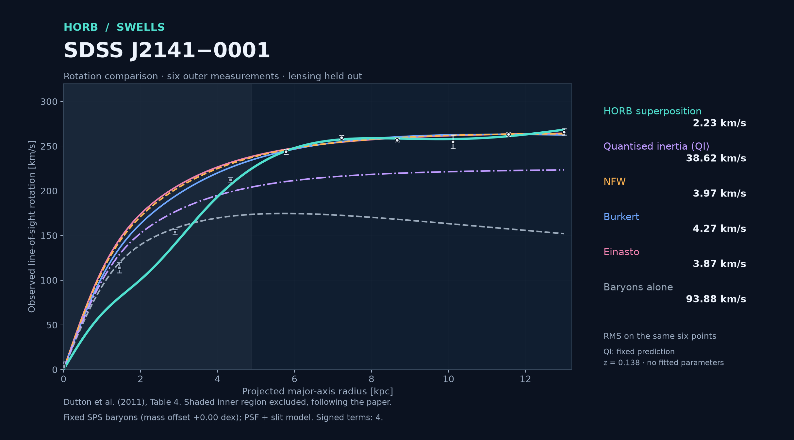

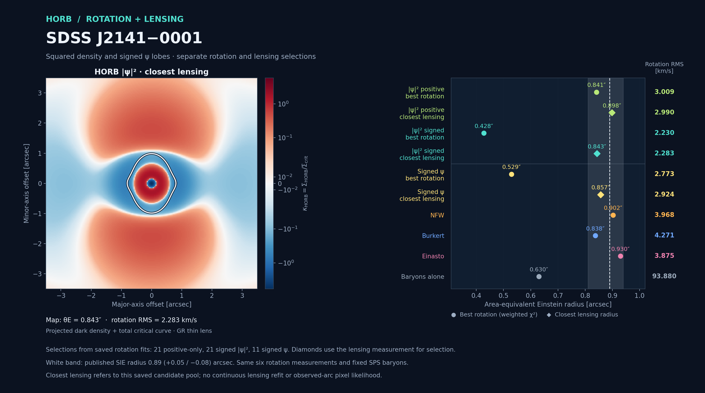

The signed-ψ density slice uses the **closest-lensing fit**, including its
3d_z2 orbital: Einstein radius **0.857″**, rotation RMS **2.924 km/s**.
Its orbitals and weights match the signed-ψ closest-lensing point above.

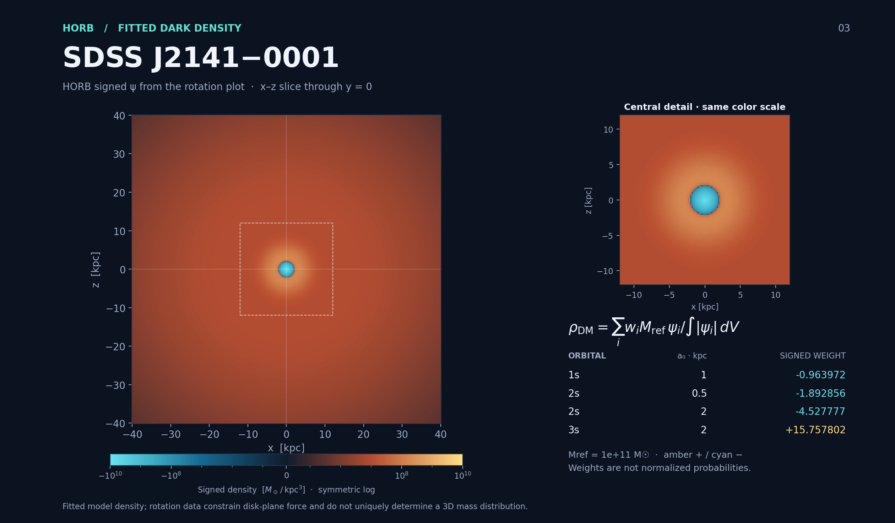

With fixed Chabrier baryons, the six HORB selections are:

| Coefficients | Selection | Rotation RMS (km/s) | Einstein radius (arcsec) |
|---|---|---:|---:|
| ψ², positive weights | Best rotation χ² | 3.009 | 0.841 |
| ψ², positive weights | Closest lensing radius | 2.990 | 0.898 |
| ψ², signed weights | Best rotation χ² | 2.230 | 0.428 |
| ψ², signed weights | Closest lensing radius | 2.283 | 0.843 |
| Signed ψ lobes | Best rotation χ² | 2.773 | 0.529 |
| Signed ψ lobes | Closest lensing radius | 2.924 | 0.857 |

The published SIE summary is 0.89 (+0.05/−0.08) arcsec. NFW, Burkert and
Einasto predict 0.902, 0.838 and 0.930 arcsec. The projected |ψ|² map and
the intrinsic signed-ψ slice each use their family's closest-lensing candidate.
The saved rotation-fitted pools contain 21 candidates in each |ψ|² family
and 11 signed-ψ candidates; selection leaves their weights unchanged.
The lensing-selected diamonds use the observed radius for selection and
are not held-out lensing tests. Six rotation measurements and this radius
summary do not identify a unique density; no image-pixel likelihood has
yet been evaluated.

```bash
./run.sh data swells
./run.sh do swells-fit
./run.sh do swells-compare
./run.sh view reports/swells/j2141_comparison/j2141_lensing.png
```

## AGN and radio-jet comparison sample

The activity catalog matches **51 SPARC galaxies** (1,472 rotation points) to
LeMMINGs radio and nuclear X-ray measurements. It includes 21 optical
Seyfert/LINER nuclei, seven priorities with resolved jet/lobe evidence, and
comparison galaxies with measured upper limits. NGC 1167 (UGC02487), with a
rotation curve reaching 80.38 kpc, is the strongest detected radio core in this
overlap. The export joins these observations to either density family's weights
and concentration metrics. For ψ it uses absolute component strength, preserving
zero-net-mass orbitals. Unknown AGN status and radio upper limits remain distinct.

```sh
./run.sh data agn --density-model psi --out-dir reports/agn_psi  # bundled 175-galaxy fits
```

```sh
./run.sh data agn
./run.sh data agn --fits-dir reports/sparc/sparc175 --out-dir reports/agn_latest
```

[Target list and analysis guide](docs/agn_rotation_sample.md) ·
[Data and provenance](data/agn/README.md).
The guide also identifies five nearby PG quasar hosts with published rotation
profiles, Mrk 231, the giant-jet spiral J2345−0449 and six radio-galaxy CO disks.
Those external curves still need numerical import. This update prepares the
weight/activity comparison; it makes no statistical correlation claim.

## License

This project is dual-licensed under either:

* Apache License, Version 2.0 ([LICENSE-APACHE](LICENSE-APACHE) or http://www.apache.org/licenses/LICENSE-2.0)
* MIT license ([LICENSE-MIT](LICENSE-MIT) or http://opensource.org/licenses/MIT)

at your option.
